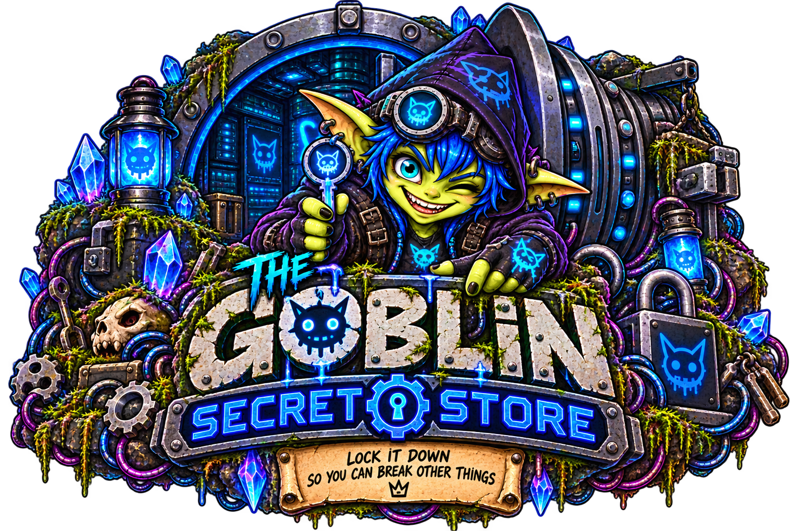

<p align="center">
  
</p>

# Goblin Secret Store [Burrow Mod]

Goblin Secret Store is a Burrow mod for keeping credentials encrypted at rest and granting agents explicit, record-level access without exposing protected values in the browser.

Operators add and replace credentials in Settings, choose which agents can use each record, and handle backup and recovery. Authorized agents can discover records and request protected values through Burrow's managed-reference tools.

It is deliberately narrow: no cloud sync, OAuth brokerage, automatic rotation, or general-purpose password-manager features. The host, operators, and authorized consumers remain trusted; read the [threat model](#threat-model) before deployment.

## Install

### Requirements

- Burrow with Git mod sources, Settings/Archive mod UI, verified operator authentication context, agent discovery, and the `mod-authorized` tool and managed-reference bridge
- A Burrow server runtime that loads the mod; standalone CLI agent runs do not load mod hosts
- Node.js **22.13 or newer** (`node:sqlite`); tested with Node 22.23.2 and 24.20.0
- Durable storage for the Burrow runtime or a dedicated `GSS_DATA_DIR`
- HTTPS and a trusted network boundary

Goblin Secret Store has no npm runtime dependencies. See [API-CONTRACT.md](API-CONTRACT.md) for its authentication and tool contract.

### Add the mod to Burrow

1. Open **Settings → Mods → Mod sources**.
2. Add `https://github.com/GoblinKing-Burrow/Goblin-Secret-Store.git` as the Git repository URL.
3. Recheck the source and select **Goblin Secret Store** from the mod catalog.
4. Install a published version, then explicitly enable the mod. Installation alone does not enable it.
5. Open **Settings → Goblin Secret Store**.

Use a version tag for stable installations. NightShaman development pushes publish the next calendar-version tag after fast standalone checks, making current mod changes immediately installable for development testing. The complete GSS/Core suite remains part of the coordinated daily public release gate.

## First credential

1. Confirm the vault storage path is on durable storage. See [Storage and lifecycle](#storage-and-lifecycle).
2. Open **Settings → Goblin Secret Store → Credentials**.
3. If Burrow authentication is enabled, your authenticated operator session is used automatically. Otherwise, the first visitor must **Claim vault** with a local password of at least 12 characters on a trusted, isolated network. On later visits, use **Unlock vault**.
4. Name the credential, choose a template, and enter its fields. Keep sensitive values in fields marked **Protected (write-only)**. Credential names and field keys are public metadata.
5. Select **Save credential**. New credentials start with no agent access.
6. Open **Agent sharing**, select the credential, and choose **Selected agents** or **All agents** under **Access scope**. Select **Save access**. All agents includes future agents.
7. Ask an authorized agent to use the credential as described below.
8. Open **Backup & restore**, download an encrypted backup, and complete a restore drill before relying on the vault.

Audit history lives in **Archive → MODS → Goblin Secret Store**.

### Have an agent use it

The enabled mod exposes provider `mod.goblin-secret-store` through Burrow's MCP tool discovery. An authorized agent uses:

1. `gss_list` to find the record ID and field names.
2. `gss_read {id}` when it needs the record's metadata and public fields.
3. `gss_use {id, field}` to request a protected field. Burrow returns an opaque `protected://` handle to the agent.
4. A compatible execution tool's `protectedBindings` to consume that handle. Current Core supports `shell_exec.protectedBindings`, mapping an environment-variable name to the returned handle.

For example, an agent can request the `token` field, bind its returned handle as `SERVICE_TOKEN`, and run an authorized program that reads that environment variable. It must use the returned handle unchanged, never put the secret in command text, and request a fresh handle if it expires. The default lifetime is 60 seconds.

GSS supplies protected values to compatible consumers; it does not automatically fill browser login forms. The receiving process or destination can access plaintext, so grant access only to agents and tasks you trust.

## Editing credentials

Protected fields are write-only in Settings: saved values cannot be revealed or copied back out. For an existing protected field with the same name and type, leave its value blank to keep it, enter a new value to replace it, or select **Replace stored value with an empty string** to clear it.

Renaming a field, changing its type, or changing whether it is protected changes that field's identity. Supply its intended value again; a blank changed field does not retain the old secret. Changing an existing credential's template keeps its fields until you adjust them explicitly.

Use **Agent sharing → Save access** to change permissions. After a restore, use **Regrant access**; editing and saving the credential alone does not reactivate its restored assignment.

## Access model

Each record has an ACL with one of three modes:

- **Nobody** — no agent can access the record.
- **Selected agents** — only the named agents can access it.
- **All agents** — every current and future agent can access it. Selecting this mode and saving is the explicit grant; there is no second confirmation dialog.

Agent identity comes only from Burrow's verified caller context, never from tool arguments. The tools are registered as `mod-authorized`, so their record ACL—not a stored per-agent MCP grant—is authoritative. To revoke access, change the record ACL or disable the provider.

References are bound to the exact agent, session, conversation, record version, and field. Editing a record, restoring a backup, revoking its ACL, disabling the provider, expiry, or restart invalidates relevant references. A grant cannot restrict where an authorized consumer sends the value, and revocation cannot retract plaintext already delivered.

Public fields, credential names, and ACL metadata are intentionally unencrypted. Never place secrets in them.

## Backups and recovery

**Settings → Goblin Secret Store → Backup & restore** can export a passphrase-encrypted portable backup containing all records and the source encryption material needed for a clean-install restore. The passphrase must be 12–1024 UTF-16 code units.

**Restore replaces every current credential; it does not merge records.** Export a backup of the destination first if you need to preserve its current contents.

1. On the destination installation, enable the mod and authenticate in Settings (or claim its local management password).
2. Open **Backup & restore → Restore backup — replaces all credentials**.
3. Select the unchanged backup file, enter its backup passphrase, and type `RESTORE`.
4. Select **Replace credentials from backup**.
5. Review each restored record under **Agent sharing** and select **Regrant access** for the intended agents.

A restore:

- validates and decrypts the complete archive before changing the vault;
- replaces records in one SQLite transaction;
- re-encrypts protected values under the destination installation key;
- preserves the destination's local management password;
- excludes sessions, audit history, and live managed references; and
- restores every ACL as inactive, including ACLs whose agent IDs still exist.

After restoring, explicitly review and reassign every ACL. Keep the archive unchanged between export and restore, preserve its passphrase separately, and test recovery regularly.

For an ordinary filesystem-copy backup or restore, stop the mod first and preserve **both** `vault.sqlite` and its matching `master.key` as a consistent pair. Protect that copy: anyone with both files can decrypt the protected fields. Restart only after the pair is in the configured data directory with the correct service ownership and permissions.

An existing database with a missing key or a key of the wrong length fails startup. A different 32-byte key cannot decrypt its protected fields. Restore the matching key or recover a portable backup into a separate clean installation; do not delete the existing database to bypass a key error.

The local management password cannot recreate a lost master key. Losing the matching key and all usable portable backups means losing the protected values.

## Storage and lifecycle

The default vault location is:

- `$BURROW_RUNTIME_ROOT/mods/mod-data/goblin-secret-store` when `BURROW_RUNTIME_ROOT` is configured;
- `/data/mods/mod-data/goblin-secret-store` in the stock container; or
- `$HOME/.local/share/goblin-secret-store` as the fallback.

Set `GSS_DATA_DIR` to an absolute path in the Burrow service environment to relocate it. Do not place it inside the mod source installation directory.

The vault directory is mode `0700`; `vault.sqlite` and `master.key` are mode `0600`. SQLite uses DELETE journal mode so there is no persistent WAL. Protected values are encrypted before being written to SQLite.

The data directory is separate from the installed mod source. Upgrade, re-enable, and restart retain it; uninstall intentionally leaves it behind. To erase the vault permanently, stop the mod and explicitly delete its data directory. Container deployments must place that directory—or its containing runtime root—on a persistent volume.

Do not run multiple Burrow instances against the same vault.

## Authentication

### Three separate secrets

- **Local management password:** authenticates operators when Burrow authentication is disabled. It does not derive or unlock the encryption key. There is currently no password-change or reset UI/API.
- **Installation master key:** the random `master.key` file loaded when the mod starts. Keep it with the matching database for filesystem recovery.
- **Backup passphrase:** encrypts a portable backup independently of the local management password. Keep it separately from the archive; it cannot be recovered from the archive.

**Unlock vault** opens management access. Logging out or letting that session expire does not revoke agent access: granted agents remain governed by their record ACLs while the provider is available. To stop their access, change the ACL or disable the provider.

### Management sessions

When Burrow authentication is enabled, Core supplies verified operator authentication and only `authenticated: true` is accepted. API bearer tokens are not treated as operators.

When Burrow authentication is disabled, the first browser visitor can create a local vault password. This bootstrap is safe only on a trusted network: isolate the service until the intended operator claims it. Local passwords use a random salt and scrypt (`N=32768`, `r=8`, `p=1`, 32-byte output). Sessions use 256-bit random tokens, stay in browser memory, and expire after one hour by default.

Logout, expiry, observed auth-mode changes, and host restart invalidate local sessions. Settings and Archive share the same memory-only session for a runtime/mod identity. Authentication loss also invalidates in-flight management loads and clears cached management metadata from mounted surfaces.

An authentication off/on round trip with no intervening mod request cannot be observed through the current Core contract. Restart the mod whenever changing Burrow authentication configuration to guarantee invalidation.

Use HTTPS. Never persist or log local session tokens, passwords, protected field drafts, or backup passphrases.

## Security at a glance

- Protected fields use AES-256-GCM with a random nonce and authenticated record/field binding.
- The vault database and its independent random 32-byte master key live outside the mod source directory.
- Protected values are never returned to the management UI after creation.
- Agents receive short-lived, caller-bound managed references rather than plaintext tool responses.
- Access is denied by default and granted per record to named agents or explicitly to all agents.
- Every protected-value use is rechecked against the current record version, caller, ACL, expiry, and provider availability.
- Management routes require an authenticated Burrow operator or, when Burrow authentication is disabled, a local vault session.
- Sensitive responses use `Cache-Control: no-store`; browser sessions remain memory-only.

Goblin Secret Store reduces accidental disclosure and limits agent access. It does **not** protect against a compromised host, Burrow service account, machine administrator, authorized consumer, or plaintext already delivered to its destination. Read [Threat model](#threat-model) before deployment.

## Threat model

Goblin Secret Store is designed to defend against:

- accidental disclosure of protected fields through the management UI or ordinary agent metadata reads;
- unauthorized agent access when record ACLs do not grant it;
- database-only theft when the independent master key is not also obtained;
- ciphertext or metadata tampering covered by AES-GCM authentication and field binding;
- stale managed references after mutation, restore, ACL change, provider loss, expiry, or restart; and
- accidental persistence of local browser sessions.

It does not defend against:

- compromise of the Burrow host, service account, process memory, master key, or machine administrator;
- a malicious or compromised operator;
- an authorized agent or destination mishandling plaintext after use;
- secrets placed in public fields, record names, logs, prompts, commands, or external systems;
- denial of service, including exhaustion of configured limits or the intentionally global login-attempt limit;
- loss of both the vault key and all usable encrypted backups; or
- concurrent access by multiple Burrow instances to the same vault directory.

Auditing records redacted issuance, use, denial, and management events. It never records protected values, passwords, or field names, but it does retain public credential names for authorized events. Treat the host, operators, authorized agents, and configured destinations as part of your trusted computing base.

## Configuration

### `GSS_DATA_DIR`

Absolute vault data directory. Relative paths are rejected.

### `GSS_LIMITS_JSON`

A JSON object containing positive integers for any of:

| Key | Default | Purpose |
| --- | ---: | --- |
| `records` | 1,000 | Maximum stored records |
| `fields` | 64 | Maximum fields per record |
| `valueBytes` | 65,536 | Maximum UTF-8 bytes per field value |
| `bodyBytes` | 16 MiB | Maximum JSON request body and restore envelope |
| `audit` | 10,000 | Retained audit events |
| `refs` | 10,000 | Concurrent live managed references |
| `sessionMs` | 3,600,000 | Local session lifetime |
| `refMs` | 60,000 | Managed-reference lifetime |

Example service environment:

```dotenv
GSS_DATA_DIR=/srv/burrow/gss
GSS_LIMITS_JSON={"records":2000,"bodyBytes":33554432}
```

Set these variables on the Burrow service that hosts the mod. Invalid keys, non-integers, and values below 1 fail startup.

The host or reverse proxy may impose a smaller body limit. Configure it to accept at least `bodyBytes`, and do not raise the mod limit beyond the host's memory and IPC budget. Backup export checks the complete UTF-8 restore envelope—including JSON escaping and passphrase overhead—and fails instead of creating an archive that cannot be restored under the configured limit.

## Troubleshooting

- **An agent sees no records:** confirm the record is granted to that agent under **Agent sharing**. Restored assignments require **Regrant access**.
- **The tools are unavailable:** check that the mod and its provider are enabled in the Burrow server runtime. Creating a separate HTTP MCP connection is not required.
- **A protected handle is rejected:** obtain a fresh one in the same agent/session/conversation. Check the record's current ACL and provider availability; edits and restores invalidate older handles.
- **`version_conflict`:** reload the current record before editing again; another change or restore made the displayed version stale.
- **`storage_key_missing` or `storage_key_invalid`:** preserve the existing files and follow [Backups and recovery](#backups-and-recovery).
- **`backup_limit` or `body_limit`:** check the configured limits and any smaller host/proxy limit. Do not modify or truncate a backup archive.

## Development

No dependency installation is needed for GSS itself. `npm run build` runs JavaScript syntax checks; it does not generate a bundle.

The full test suite imports a sibling `Burrow-Backend` checkout by default. Override it with `BURROW_CORE_ROOT`. Before running `npm test`, install that checkout's dependencies and provide PostgreSQL 17 with pgvector. The integration fixture must run as a non-root user; it owns a disposable cluster over a private Unix socket and fails rather than skips when prerequisites are missing. Override PostgreSQL binaries with `BURROW_POSTGRES_BIN_DIR` when they are not under `/usr/lib/postgresql/17/bin`.

```sh
git clone https://github.com/GoblinKing-Burrow/Goblin-Secret-Store.git
cd Goblin-Secret-Store
npm run build
npm test
```

To verify the minimum supported Node line explicitly:

```sh
npx --yes --package=node@22 node --test server/*.test.mjs ui/*.test.mjs
```

See [API-CONTRACT.md](API-CONTRACT.md) for the browser/API contract and tool semantics.
